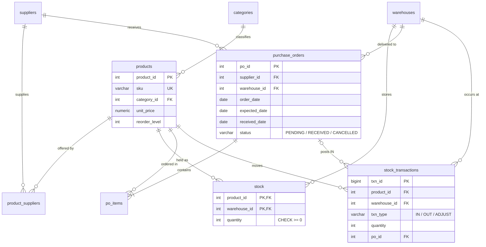

# Enterprise Inventory Database Management System

[](https://github.com/YOUR_USERNAME/enterprise-inventory-dbms/actions/workflows/ci.yml)


A normalized (3NF) PostgreSQL database for an enterprise inventory workflow: products, suppliers, multi-warehouse stock, purchase orders and a full stock-movement ledger. It is built to show relational design, data integrity, query optimization and transaction management, and everything is **runnable and tested**.

> The data is synthetic (generated by `sql/02_seed_data.sql`), so you can rebuild the identical database any time.

## What this demonstrates

| Area | What's in the repo |
|---|---|
| **Schema design** | 9 tables in 3NF; many-to-many resolved with `product_suppliers`; ledger table for a full audit trail |
| **Data integrity** | Primary/foreign keys, `NOT NULL`, `UNIQUE`, 17 `CHECK` constraints (e.g. stock can never go negative, a PO is `RECEIVED` only if it has a received date) |
| **Indexing** | FK indexes, composite `(product_id, txn_time)`, and a partial index for open POs, with before/after `EXPLAIN ANALYZE` |
| **Complex SQL** | Joins, `LATERAL`, CTEs, window functions (running balance, `RANK`), `FILTER` aggregates, `DISTINCT ON` |
| **Transactions / ACID** | Rollback, savepoints, constraint rejection, WAL durability, an atomic `issue_stock()` procedure |
| **Concurrency** | Two live sessions: lost-update prevention with `FOR UPDATE`, isolation levels, a real deadlock and its fix |
| **Testing & CI** | 13 automated assertions (`sql/06_tests.sql`) and a GitHub Actions workflow that builds the DB and runs everything |

## Quick start

**Option A - Docker (recommended)**

```bash
git clone https://github.com/YOUR_USERNAME/enterprise-inventory-dbms.git
cd enterprise-inventory-dbms
make up        # starts PostgreSQL 16 in Docker
make all       # build schema + data, run tests, queries and all demos
```

**Option B - your own PostgreSQL (14+)**

```bash
make all PGHOST=localhost PGUSER=postgres PGPASSWORD=yourpassword
```

You need `make` and the `psql` client installed. `make help` lists every target:

| Command | Does |
|---|---|
| `make setup` | Create database, schema, indexes and sample data |
| `make test` | Run the 13 integrity / constraint tests (non-zero exit on failure) |
| `make queries` | Run the analytical queries |
| `make demo-index` | `EXPLAIN ANALYZE` with and without an index |
| `make demo-acid` | Atomicity, consistency, savepoints, durability |
| `make demo-concurrency` | Two-session locking, isolation and deadlock demo |
| `make psql` | Open an interactive shell on the database |
| `make down` / `make clean` | Stop the container / also delete its data |

Real output from a full run is saved in [`docs/sample_output.txt`](docs/sample_output.txt).

## Schema



**Key design choice:** `stock` holds the current quantity (fast reads) and `stock_transactions` is an append-only ledger (audit trail). The two must always agree, and a test checks that after every run, including after the concurrency demos. More in [`docs/DESIGN.md`](docs/DESIGN.md).

## Results from a real run

**Indexing** (250k-row ledger, query: one product in one month)

| | Plan | Execution time |
|---|---|---|
| No index | Parallel Seq Scan, ~252k rows filtered out | ~12 ms |
| Composite index `(product_id, txn_time)` | Bitmap Index Scan | ~0.25 ms |

That is roughly a **40-50x** speedup (exact timings vary by machine). Full plans are in `sample_output.txt`.

**Concurrency** (`make demo-concurrency`)

- *Lost update prevented:* stock 100; session A issues 30 while session B issues 20. B waits for A's row lock, and the final value is 50, as it should be.
- *Isolation levels:* while a transaction is open, another session commits a change. `READ COMMITTED` sees it (100 → 40); `REPEATABLE READ` keeps its snapshot (100 → 100).
- *Deadlock:* two sessions lock the same two rows in opposite order, and PostgreSQL aborts one. Locking in a consistent order makes both commit.

**Sample query - reorder report** (low stock, with the cheapest supplier and lead time):

```
 warehouse         | sku      | on_hand | reorder_level | suggested_order_qty | cheapest_supplier | unit_cost | lead_time_days
 Central Warehouse | SKU-0009 |       3 |            73 |                 143 | Fortune Packaging |    880.97 |             14
 East Depot        | SKU-0012 |       1 |            48 |                  95 | Fortune Packaging |   1467.46 |             14
```

## Repository layout

```
.
├── sql/
│   ├── 01_schema.sql              # tables, constraints, indexes, issue_stock() procedure
│   ├── 02_seed_data.sql           # deterministic synthetic data
│   ├── 03_queries.sql             # analytical queries (Q1-Q8)
│   ├── 04_indexing_demo.sql       # EXPLAIN ANALYZE before / after
│   ├── 05_transactions_acid.sql   # ACID demos
│   └── 06_tests.sql               # 13 integrity & constraint assertions
├── scripts/
│   └── concurrency_demo.sh        # two-session locking / isolation / deadlock demo
├── docs/
│   ├── DESIGN.md                  # design decisions & trade-offs
│   ├── INTERVIEW_NOTES.md         # how to present and defend this project
│   └── sample_output.txt          # captured output of a full run
├── .github/workflows/ci.yml       # builds the DB and runs everything on every push
├── docker-compose.yml             # PostgreSQL 16
├── Makefile
└── LICENSE
```

## Limitations

- Data is synthetic and small (a few thousand rows, plus a 250k-row load for the index demo), so timings show the effect of indexing rather than production performance.
- It is a database-layer project: there is no application or UI on top.
- The seed is deterministic for the same PostgreSQL version; a different major version may generate slightly different random values.

## License

MIT - see [LICENSE](LICENSE).
